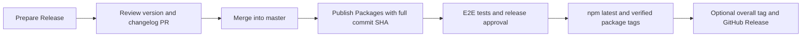

# Release stable Suites packages

Releases use `master` and npm's `latest` tag. Lerna calculates independent package versions and changelogs from conventional commits. `suites-release-bot` opens the version PR, pushes signed package tags, and creates GitHub Releases; npm authenticates separately through Trusted Publishing.

## One-time setup

The organization owns `suites-release-bot`. Install it on the repositories that should use it, with **Contents: read/write**, **Pull requests: read/write**, and **Metadata: read**. No branch-protection bypass is required.

Configure these organization Actions settings:

| Setting                                 | Value                                                                           |
| --------------------------------------- | ------------------------------------------------------------------------------- |
| Variable `SUITES_RELEASE_APP_CLIENT_ID` | The app's client ID                                                             |
| Secret `SUITES_RELEASE_APP_PRIVATE_KEY` | The downloaded PEM private key, accessible to release-enabled repositories only |

Each workflow mints a short-lived token restricted to its own repository. The token action revokes it at job completion. Keep the PEM out of Git and workflow logs.

In `unit`, configure the `release` environment to require review by `omermorad` and allow deployment from `master` only.

Register a dedicated Ed25519 public key as a **Signing Key** on the release signer's GitHub account. Keep it separate from SSH authentication and from the GitHub App PEM. In Unit's protected `release` environment configure:

| Setting                                      | Value                                                        |
| -------------------------------------------- | ------------------------------------------------------------ |
| Secret `SUITES_RELEASE_SIGNING_PRIVATE_KEY`  | Dedicated unencrypted OpenSSH private key                    |
| Variable `SUITES_RELEASE_SIGNING_PUBLIC_KEY` | Matching `ssh-ed25519` public key                            |
| Variable `SUITES_RELEASE_SIGNING_LOGIN`      | GitHub account owning the signing key, currently `omermorad` |

Tags are signed under this account's name and GitHub noreply email. The Release Bot still authenticates the push and creates the GitHub Releases. Before npm publication, the workflow checks that the public key is registered and proves the runner can sign and verify. The private key is removed from the runner in an `always()` cleanup step.

GitHub's **Verified** badge is checked on each new annotated tag object through the API. `gh release create --verify-tag` only checks that a tag exists; it does not verify signatures. See [GitHub signing keys](https://docs.github.com/en/authentication/managing-commit-signature-verification/signing-tags).

For each of these npm packages, open **Settings → Trusted Publisher → GitHub Actions**:

- `@suites/unit`
- `@suites/core.unit`
- `@suites/di.nestjs`
- `@suites/di.inversify`
- `@suites/doubles.jest`
- `@suites/doubles.vitest`
- `@suites/types.common`
- `@suites/types.di`
- `@suites/types.doubles`

Use these exact values:

| npm field            | Value                  |
| -------------------- | ---------------------- |
| Organization or user | `suites-dev`           |
| Repository           | `unit`                 |
| Workflow filename    | `publish-packages.yml` |
| Environment          | `release`              |

The package repository URL must be `https://github.com/suites-dev/unit.git`. See [npm Trusted Publishing](https://docs.npmjs.com/trusted-publishers/) for authentication requirements. The release workflows do not use `GH_TOKEN` or `NPM_TOKEN` secrets.

## Prepare and review versions

1. Run **Prepare Release** from `master`.
2. Choose `graduate` for the first stable release from the staged prereleases, or `stable` for subsequent conventional-commit releases.
3. Wait for the E2E matrix. The bot then opens a PR containing package versions, dependency ranges, the lockfile, and changelogs.
4. Review each changed package's version and release notes, including its `BREAKING CHANGE:` entries. Merge after CI passes and human review is complete.

Preparation never pushes directly to `master`, publishes npm packages, or creates tags. Keep feature commits and their scopes and breaking-change footers in Git history so Lerna can generate meaningful package changelogs.

## Publish the reviewed commit

1. Copy the full 40-character merge commit SHA at the head of `master`.
2. Run **Publish Packages** from `master`, supplying that SHA as `commit`. For the overall Suites 4 release, also set `release_tag` to `v4.0.0`. Leave it empty for a package-only release.
3. Read the publication plan and wait for E2E tests on that exact commit.
4. Approve the `release` environment deployment.

The supplied commit must equal the workflow's dispatch commit. This keeps npm provenance, the tested source, and `gitHead` aligned. If `master` advanced before dispatch, review its new head and dispatch again with that SHA.

The workflow builds, lints, and tests; rechecks existing versions and tags; publishes missing stable versions to `latest`; verifies npm metadata and downloadable tarballs; then signs and atomically pushes missing package tags. It verifies their signatures on GitHub and creates GitHub Releases using each package's changelog entry.

Expected package tags look like `@suites/unit@4.0.0`. Packages retain independent versions, and existing tags are never moved.

When `release_tag` is supplied, it must equal `v` plus the reviewed `@suites/unit` version, and that package must belong to this release commit. After all package tags are verified and package releases are complete, the workflow creates and verifies the signed overall tag at the same commit. It then creates the **Suites v4.0.0** GitHub Release as Latest with links and changelog entries for the packages. Package releases remain marked `latest=false`.

Merging a version PR does not create tags. Do not create the overall tag manually before this sequence completes.

## Recover a failed release

Re-run the failed workflow using the same commit after fixing the cause. Do not bump versions merely because a network request failed.

- **Checkout or bot authentication:** verify the app installation includes `unit`, and the organization variable and secret are accessible to it.
- **Signing setup:** confirm the public key is registered as a Signing Key on the configured account and matches the environment secret. Key setup failures stop before npm publication.
- **Unverified tag:** inspect the tag object and GitHub verification reason. Do not overwrite it; rerun the same commit only after verification succeeds. An unsigned tag collision requires investigation because existing tags are immutable.
- **npm authentication:** check all nine Trusted Publisher entries, especially the exact workflow filename and `release` environment. No long-lived npm token is needed.
- **Partial npm upload:** existing versions are checked against their source commit and package contents. Matching published packages are preserved, and Lerna publishes only missing versions.
- **Registry propagation:** verification retries read-only checks for new versions for up to ten minutes. It never retries an upload itself.
- **Wrong source, changed package contents, or tag collision:** stop and inspect. A changed package needs a new version; never overwrite or move an existing release tag.
- **Published version with an unexpected `latest` tag:** inspect npm before proceeding. The workflow refuses to silently move an unexpected tag.
- **Tags or GitHub Releases failed after npm succeeded:** rerun with the same commit. Matching versions and tags are preserved; missing tags and GitHub Releases are completed.

Unchanged independent packages may keep an earlier `gitHead`, tag, and `latest` value. The workflow accepts this only when the earlier source is an ancestor and that package's tracked contents are unchanged.
